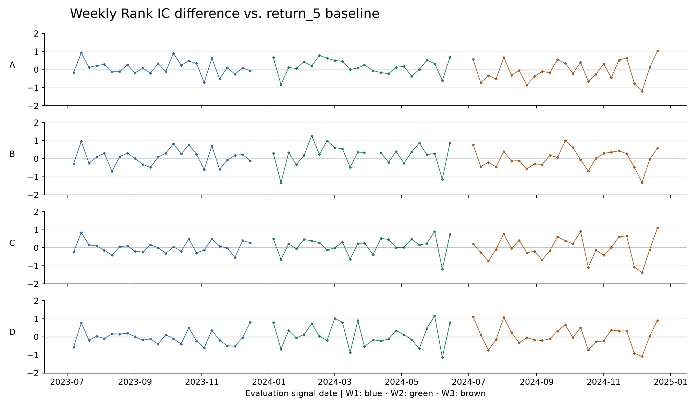

# 第 3 步 · 时间验证与稳定性

没有一个模型在三个窗口都超过简单排序基准的平均 Rank IC。A、B、C 在 W1 和 W2 领先，到了 W3 均落后。D 在 W1 落后，在 W2 和 W3 领先。七特征回归 B 在全部 73 个评估周合并后取得最高平均 Rank IC。七特征直接排序 D 只在 W3 超过 B。

## 分窗口结果

每格为「平均 Rank IC / 平均 Top 3 重合率」。A、B 为四特征和七特征回归排序，C、D 为四特征和七特征直接排序。

| 评估窗口 | 周数 | 简单基准 | A | B | C | D |
|---|---:|---:|---:|---:|---:|---:|
| W1 · 2023 下半年 | 24 | −0.0405 / 23.61% | 0.0721 / 33.33% | 0.0450 / 33.33% | −0.0167 / 31.94% | −0.0811 / 26.39% |
| W2 · 2024 上半年 | 24 | −0.1561 / 23.61% | 0.0051 / 31.94% | 0.0399 / 31.94% | −0.0239 / 25.00% | −0.0360 / 23.61% |
| W3 · 2024 下半年 | 25 | 0.0178 / 25.33% | −0.0520 / 22.67% | 0.0169 / 22.67% | −0.0087 / 29.33% | 0.0604 / 30.67% |
| 全部评估周 | 73 | −0.0585 / 24.20% | 0.0076 / 29.22% | 0.0336 / 29.22% | −0.0163 / 28.77% | −0.0178 / 26.94% |
| 2024 评估周 | 49 | −0.0673 / 24.49% | −0.0240 / 27.21% | 0.0279 / 27.21% | −0.0161 / 27.21% | 0.0132 / 27.21% |

B 在 2024 年 4 月 5 日给出 11 个相同分数，故该周 IC 留空并排除出 B 的配对 IC，Top 3 仍按代码升序取三只。其余方法每周 IC 均有效。下表使用双方均有效的周，记录相对基准 IC 的胜／负／平周数。Top 3 也使用相同的配对规则单独计数，详见 [配对汇总](run_01/paired_summary.csv)。

| 窗口 | A | B | C | D |
|---|---:|---:|---:|---:|
| W1 | 14／10／0 | 15／9／0 | 13／11／0 | 10／14／0 |
| W2 | 18／6／0 | 17／6／0 | 17／6／1 | 13／11／0 |
| W3 | 10／15／0 | 12／13／0 | 11／14／0 | 12／13／0 |
| 全部评估周 | 42／31／0 | 44／28／0 | 41／31／1 | 35／38／0 |



在 2024 年的 49 个保留评估周里，A、B、C、D 的平均配对 IC 差分别为 +0.0433、+0.1010、+0.0512、+0.0805。逐模型删去其优势最大的三周后，分别变为 −0.0084、+0.0353、−0.0088、+0.0128。A、C 的全年评估优势依赖少数周，B 和 D 剩余周仍有正差。合并 73 周时，D 虽平均领先 0.0407，却仅胜 35 周、负 38 周，去掉优势最大的三周后转为 −0.0055。以上每周以 11 只 ETF 的横截面作为一个观察组。

## 失败案例 · 2024 年 6 月 7 日

按预定规则，D 相对基准的最低配对 IC 差为 **−1.1455**。该周 D 的 Rank IC 为 −0.6727，基准为 +0.4727。持有期为 6 月 10 日开盘至 6 月 17 日开盘。

| 排序方法 | 预测前三（括号内为实际排名） |
|---|---|
| 简单基准 | XLK（1）、XLV（6）、XLC（5） |
| A | XLE（11）、XLB（7）、XLK（1） |
| B | XLE（11）、XLI（8）、XLB（7） |
| C | XLF（10）、XLE（11）、XLP（9） |
| D | XLE（11）、XLF（10）、XLV（6） |
| 实际前三 | XLK（+6.22%）、XLRE（+1.24%）、XLY（+0.54%） |

D 将实际前两名中的 XLK、XLRE 排在第 10 和第 8 名，将实际末两名 XLE、XLF 排在前两位。这些名次和收益可从 [该周 11 只 ETF 排名](run_01/failure_ranks.csv) 核实。短中期历史特征与该持有期行业强弱的关系可能发生了反转，这需要更多周或独立事件数据检验。

## 边界与复现

| 窗口 | 拟合周／样本 | 选参周／样本 | 评估周／样本 | 评估信号日 |
|---|---:|---:|---:|---|
| W1 | 98／1,078 | 24／264 | 24／264 | 2023-07-07 至 2023-12-15 |
| W2 | 124／1,364 | 24／264 | 24／264 | 2024-01-05 至 2024-06-14 |
| W3 | 150／1,650 | 24／264 | 25／275 | 2024-07-05 至 2024-12-20 |

三个窗口都达到预定周数，沿用用户给定的时间安排。拟合标签在选参首个信号前已实现，选参标签在评估首个信号前已实现。共记录 17 条按窗口与阶段计数的边界剔除。同一个日历周可在不同窗口承担不同阶段，73 个评估信号日期均唯一。核对了实际时点、每周完整 ETF 组和逐周指标。前期研究使用过 2023–2024 年数据，本步是按窗隔离标签的回顾性验证。原 2025 年探索性结果独立保留。

```bash
.venv/bin/python experiments/sector_ranking/03_walk_forward/run.py --run-name run_02
```

- [设计规则](DESIGN.md)、[日期与样本量](run_01/phase_windows.csv)、[完整阶段核查](run_01/phase_audit.csv)、[边界剔除记录](run_01/boundary_exclusions.csv)
- [分窗汇总](run_01/summary.csv)、[逐周指标](run_01/weekly_metrics.csv)、[逐周配对差值](run_01/weekly_deltas.csv)、[配对胜负与集中度](run_01/paired_summary.csv)
- [评估分数](run_01/eval_scores.csv)、[选参记录](run_01/grid.csv)、[参数及输入输出指纹](run_01/experiment.json)
